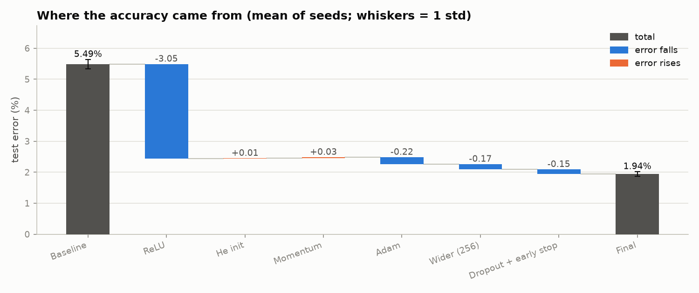
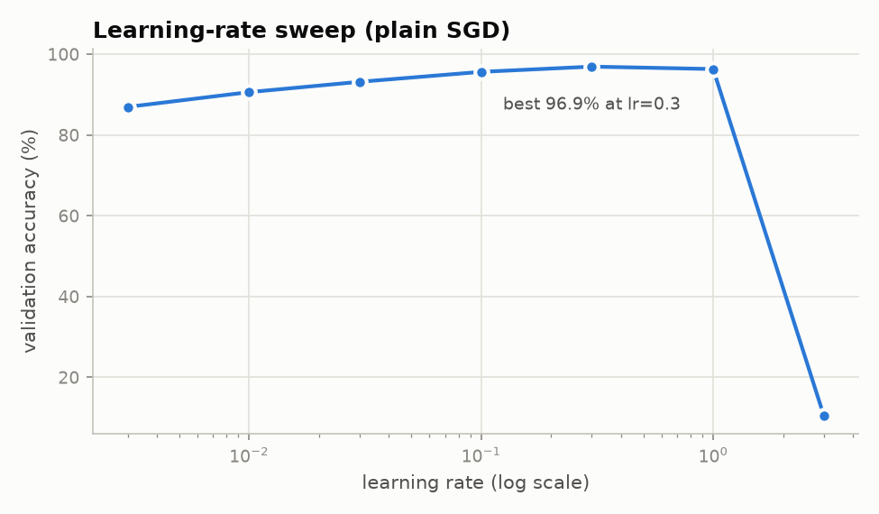
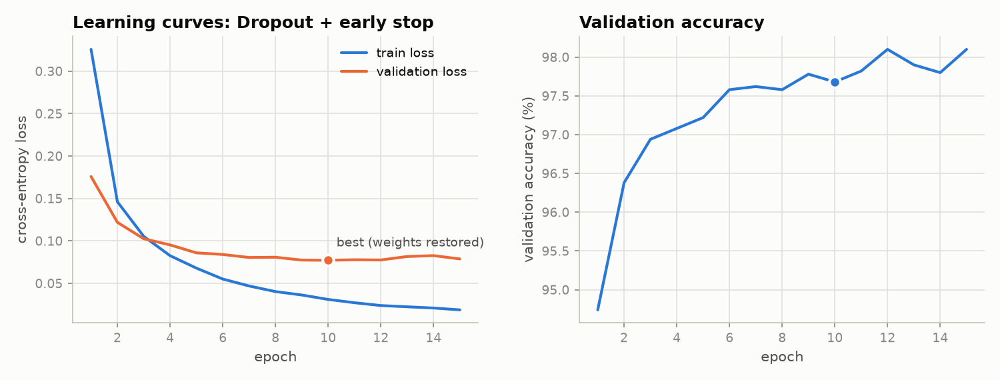
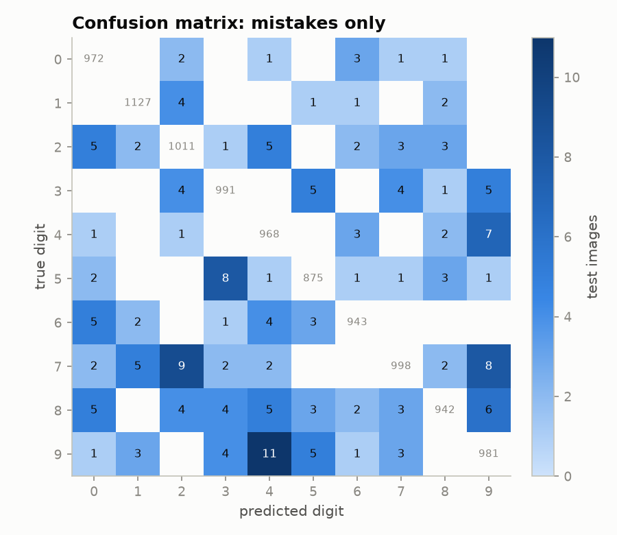
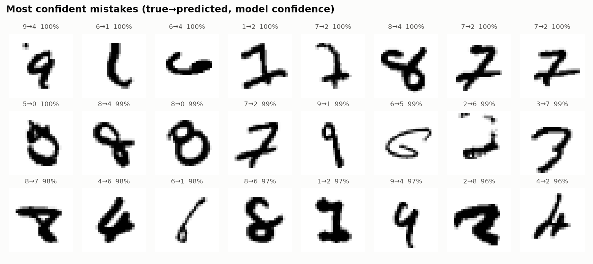
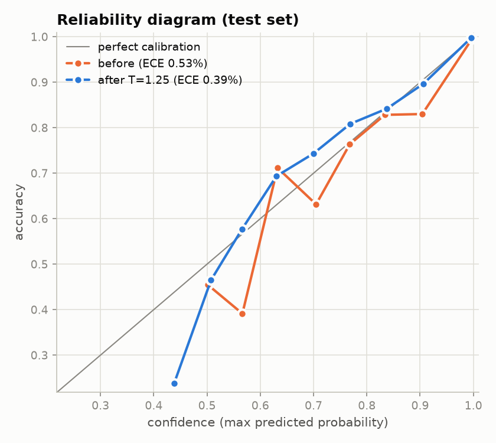
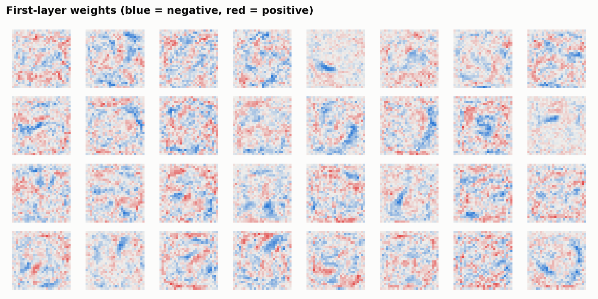
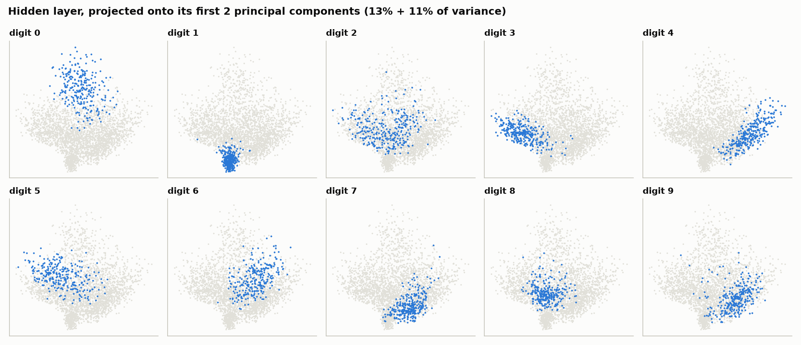
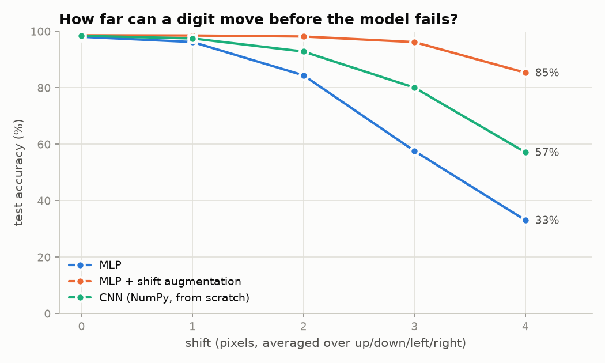

# Handwritten digit recognition from first principles

A small neural-network library written in NumPy (layers, backpropagation,
SGD/momentum/Adam, dropout, convolution), verified against numerical gradients
and used to study *why* a model works, not just how well. On MNIST:

- an ablation study takes the original network from **94.51%** to **98.06%**
  test accuracy, cutting the error rate from 5.5% to 1.9%;
- paired significance tests, checked across seeds, show that one change did
  most of the work and several did little or nothing;
- a robustness study shows that shifting digits by 3 pixels drops the MLP to
  **57.6%**, and that data augmentation brings it back to **96.2%**.

**[Live demo: draw a digit in your browser](https://ilovespectraltheorem.github.io/mnist-from-scratch/demo/)**

| Model | Test accuracy | Shifted 3 px |
|---|---|---|
| Original network (sigmoid, plain SGD) | 94.51% ± 0.15 | |
| Final MLP (ReLU, Adam, 256 hidden, dropout, early stopping) | 98.06% ± 0.08 | 57.6% |
| Final MLP + shift augmentation | 98.61% | **96.2%** |
| CNN (NumPy, 2 conv layers, 5 epochs) | 98.44% | 80.1% |

± is the standard deviation over 3 random seeds. No PyTorch, TensorFlow or
scikit-learn: everything is NumPy, with matplotlib for the figures.

---

## 1. A small deep-learning library, verified

`src/layers.py` · `src/losses.py` · `src/network.py` · `src/optimizers.py` · `src/conv.py`

Every layer implements `forward` and `backward`, a network is a list of layers,
and backpropagation is the chain rule applied layer by layer. Softmax and
cross-entropy are combined so their gradient is simply (p − y)/N, computed with
the log-sum-exp trick so it never takes log(0). The CNN uses im2col, which turns
convolution into one matrix multiply.

To check every backward pass, `src/gradcheck.py` compares the analytic gradients
with central-difference estimates, (L(w+ε) − L(w−ε)) / 2ε, for every parameter
and for the input:

| Network | Largest relative error |
|---|---|
| MLP, ReLU (3 layers) | 8.2e-11 |
| MLP, sigmoid | 2.4e-10 |
| CNN (conv, ReLU, max-pool, dense) | 1.1e-10 |

Errors around 1e-10 are floating-point rounding; a wrong derivative shows up
around 1e-2 or worse. The full table is in `results/gradcheck.md`.

## 2. Ablation: where the accuracy came from

Starting from the original network (784-128-10, sigmoid, SGD with learning rate
0.1), each step changes one thing and keeps the earlier changes. Every step is
trained with 3 seeds on 55,000 images, early stopping uses a separate
5,000-image validation set, and no setting was chosen by test accuracy.



Changes below are means over the 3 seeds.

- **ReLU did almost all the work** (+3.05 points). A sigmoid's derivative is at
  most 0.25 and close to zero when it saturates, so with the same learning rate
  and number of epochs the sigmoid network learns far more slowly.
- **He initialisation changed nothing** (−0.01; on seed 0 it fixed exactly as
  many images as it broke, 30 each). With a single hidden layer the starting
  scale barely matters; its benefit grows with depth.
- **Momentum made no consistent difference** (−0.03). The learning rate was cut
  10× so the effective step lr/(1 − momentum) stayed the same, so this step
  measures momentum itself rather than a bigger step.
- **Adam (+0.22) and a wider hidden layer (+0.17)** gave small gains that held
  on every seed. **Dropout with early stopping (+0.15)** helped on every seed
  too, but by as little as +0.05 on seed 0.



The learning-rate sweep (plain SGD, 5 epochs, validation accuracy) shows the
usual shape: accuracy climbs with the learning rate up to 0.3, falls slightly
at 1.0, and the run diverges at 3.0 (10.5%, chance level).



In the final model's learning curves, validation *loss* stops improving at
epoch 10 while validation *accuracy* keeps rising: the model keeps getting more
confident faster than it keeps getting more accurate. Section 4 measures that.

## 3. Are the improvements real?

With 10,000 test images, an accuracy near 98% has a 95% confidence interval of
about ±0.27 points, so most of the later steps can't be separated by their
intervals alone. Comparing two models on the *same* images is far more
sensitive, so each step is tested with McNemar's test and a paired bootstrap
(`src/stats.py`, seed 0). The last row compares two seeds of the *same* model:
the noise floor.

| Comparison | Change | 95% CI of change | Paired bootstrap p | McNemar p (exact) | Fixed / broken |
|---|---|---|---|---|---|
| Baseline → ReLU | +3.17 pts | [+2.80, +3.55] | < 0.0001 | 5.5e-68 | 350 / 33 |
| ReLU → He init | +0.00 pts | [−0.15, +0.15] | 1.00 | 1 | 30 / 30 |
| He init → Momentum | −0.17 pts | [−0.30, −0.04] | 0.015 | 0.019 | 15 / 32 |
| Momentum → Adam | +0.30 pts | [+0.06, +0.55] | 0.018 | 0.02 | 93 / 63 |
| Adam → Wider (256) | +0.24 pts | [+0.00, +0.48] | 0.054 | 0.058 | 86 / 62 |
| Wider → Dropout + early stop | +0.05 pts | [−0.16, +0.26] | 0.68 | 0.71 | 61 / 56 |
| Baseline → final | +3.59 pts | [+3.20, +3.99] | < 0.0001 | 1.5e-78 | 393 / 34 |
| *Same model, different seed* | −0.11 pts | [−0.34, +0.12] | 0.36 | 0.39 | 61 / 72 |

Only ReLU is unambiguous. Adam is significant and positive on every seed; the
wider layer is borderline.

The momentum row is the instructive one. On seed 0 both tests call it
significantly *worse* (p ≈ 0.02), yet on the other two seeds momentum came out
slightly *ahead* (+0.05 and +0.02 points). A paired test on one seed captures
the noise from which images happen to be in the test set, but not the noise
from training itself. A result has to survive both, and the last row shows the
size of the second kind: two seeds of the same model differ by 0.11 points.

## 4. What the model gets wrong, and how confident it is



The most common mistakes are 9 → 4 (11 images), 7 → 2 (9), 5 → 3 (8),
7 → 9 (8) and 4 → 9 (7): open-topped 4s and 9s, and 7s written with a
crossbar or a curled foot. The most confident mistakes are mostly digits a
person would also hesitate over:



**Calibration.** When the model says it's 90% sure, is it right 90% of the
time? The final MLP is slightly over-confident: its average confidence is
98.49% against an accuracy of 98.08%. Temperature scaling, which divides every
logit by one number T fitted on the validation set (T = 1.25), cuts the
expected calibration error from 0.53% to 0.39%. Accuracy is unchanged, because
dividing all logits by the same T never changes which class is largest.



**What did it learn?** The first-layer weights, and the hidden layer projected
onto its first two principal components (PCA via SVD, 13% + 11% of the
variance). 0s and 1s form tight, separate clusters; 4, 7 and 9 overlap, which
matches the confusion matrix.




## 5. Robustness: shifting the digits

An MLP treats every pixel as an unrelated input, so it has no built-in idea
that a shifted 3 is still a 3. MNIST hides this because every digit is
centred. Here the test digits are shifted up, down, left and right:



| Shift (pixels) | 0 | 1 | 2 | 3 | 4 |
|---|---|---|---|---|---|
| MLP | 98.1% | 96.2% | 84.4% | 57.6% | 33.1% |
| MLP + shift augmentation (±2 px) | 98.6% | 98.5% | 98.2% | 96.2% | 85.4% |
| CNN | 98.4% | 97.5% | 92.9% | 80.1% | 57.2% |

- **Augmentation** (training on randomly shifted copies) teaches the invariance
  through the data, and it also raises accuracy on unshifted digits, since it
  acts as a regulariser.
- **The CNN** degrades more gracefully than the MLP without seeing a single
  shifted example. Convolution is shift-*equivariant* and pooling adds a little
  local invariance, but its final dense layer is not shift-invariant, so
  architecture alone doesn't solve the problem.

The same issue is why the drawing demo crops each drawing, scales it into a
20×20 box and centres it by centre of mass, exactly as MNIST was prepared
(`preprocess_drawing` in `src/robustness.py`).

## 6. Live demo

`demo/index.html` runs the augmented MLP (784-256-10, 203,530 parameters) in the
browser. `src/export.py` writes the weights to `demo/model.js`, and the page
reimplements the forward pass in plain JavaScript. On load, it recomputes the
probabilities for a reference image and checks they match Python's.

## How to run

```bash
pip install -r requirements.txt
# put the four MNIST .idx-ubyte files in data/
python main.py gradcheck       # gradient check
python main.py all             # every experiment and figure (about 15 minutes on a laptop)
python main.py export          # then open demo/index.html
python main.py draw            # desktop drawing app (needs tkinter)
```

All settings live in `config.py`. Every run is seeded, so the numbers above
reproduce exactly.

## Limitations and next steps

- MNIST is easy and pre-centred; the robustness section exists partly to show
  how much that flatters a plain MLP.
- The ablation is cumulative, so each step's effect is measured given the steps
  before it: in a different order, He initialisation or momentum might look
  different.
- The paired tests use one seed per model, so they ignore training noise (see
  the momentum row). Repeating them for every seed pair, or training more seeds,
  would give a sharper answer for the small steps.
- The CNN was trained for only 5 epochs and without augmentation; a CNN with
  augmentation is the obvious next comparison (`python main.py robustness --cnn-aug`).
- Next: batch normalisation, AdamW (decoupled weight decay), and a harder
  dataset such as Fashion-MNIST, where the gaps between these choices should
  be larger.

## Layout

```
config.py            every setting in one place
main.py              runs everything: python main.py <command>
src/
  data.py            reading the IDX files, validation split, mini-batches
  layers.py          Linear, ReLU, Sigmoid, Dropout, Flatten, Reshape
  losses.py          softmax cross-entropy
  network.py         Sequential container and inference
  optimizers.py      SGD (momentum, weight decay) and Adam
  gradcheck.py       numerical gradient checking
  train.py           training loop with early stopping
  experiments.py     model building, ablation study, learning-rate sweep
  stats.py           confidence intervals, paired bootstrap, McNemar's test
  analysis.py        confusion matrix, precision/recall, PCA
  calibration.py     reliability diagram, ECE, temperature scaling
  robustness.py      shift experiments, augmentation, drawing preprocessing
  conv.py            Conv2D (im2col) and MaxPool2D
  export.py          weights for the web demo
  plots.py           figures
demo/                the web demo
results/             numbers (JSON/Markdown) and figures
legacy/              the original version of this project
```
